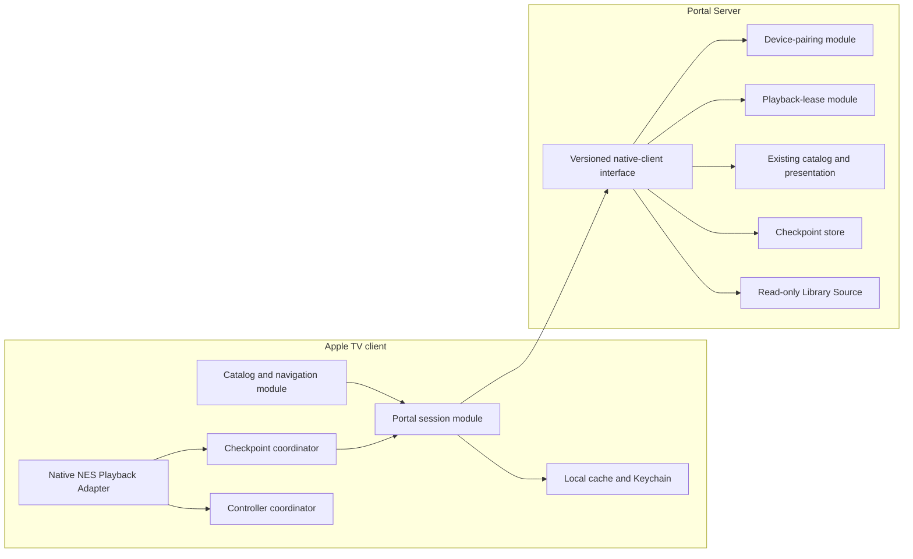

# Apple TV Client v1 Specification

Status: Approved product direction; implementation-ready draft  
Date: 2026-09-02  
Product: Home Game Portal  
Target: Private household beta designed toward App Store compliance

## 1. Product definition

Home Game Portal for Apple TV is a native tvOS client for one or more Portal Servers on a trusted home network. A Portal Server remains authoritative for the Catalog, Game Files, Player Profiles, presentation, play history, Favorites, and Checkpoints. The Apple TV temporarily downloads a selected Game File, emulates it locally, and synchronizes progress back to that server.

The app should feel like the web portal brought deliberately to television: the same brand, themes, artwork, content hierarchy, and player-facing capabilities, expressed through native tvOS focus, layout, accessibility, and controller behavior.

### 1.1 Goals

1. Let a household connect and pair an Apple TV with a Portal Server without editing app configuration.
2. Provide native versions of Who's Playing, Browse, Collections, My Library, Search, game details, Favorites, Continue Playing, appearance, and controller settings.
3. Play NES Game Files locally at stable 60 fps with one or two physical controllers.
4. Resume compatible Checkpoints across the web and Apple TV clients in either direction.
5. Preserve progress across normal exit, backgrounding, brief network loss, crashes, and session conflicts.
6. Support several saved Portal Servers while keeping data and identity scoped to one active server.
7. Remain private, telemetry-free, and suitable for a TestFlight household beta.

### 1.2 Non-goals for v1

- Internet-facing or remote-server access
- A merged Catalog spanning several Portal Servers
- Apple TV HD support
- SNES, Atari 2600, Famicom Disk System, or non-`.nes` playback
- Siri Remote gameplay; it remains a navigation device
- Intentional offline Game File downloads or a user-managed offline library
- Library Source configuration, rescans, metadata correction, Collection editing, Browse Row editing, or Player Profile identity management
- Profile PINs
- Rewind, fast-forward, cheats, netplay, CRT shaders, arbitrary save slots, achievements, or Game Center
- tvOS Top Shelf integration
- Third-party analytics or automatic crash-report transmission

## 2. Confirmed product decisions

| Area | v1 decision |
| --- | --- |
| Distribution | Xcode during development; TestFlight for the household beta |
| Hardware | Apple TV 4K, second generation or newer |
| OS | tvOS 26 or newer; reassess before the first TestFlight upload |
| Network | Trusted LAN only |
| Servers | Save several; select exactly one active Portal Server |
| Discovery | Bonjour plus manual hostname/IP and port entry |
| Authorization | Mandatory administrator-approved Device Pairing |
| Profiles | Select existing server-owned profiles; no PIN and no identity editing on TV |
| UI | Native tvOS behavior with web-portal visual and functional continuity |
| Playback | Temporary local emulation; NES only; pinned FCEUmm core |
| Controllers | Physical game controller required; up to two local players; custom mappings |
| Progress | Automatic, versioned Checkpoints with web/tvOS compatibility and rollback |
| Concurrent play | One Playback Lease per Player Profile and Game, with explicit takeover |
| Privacy | No third-party telemetry and no external library-data transmission |
| Source | Publish corresponding source and notices required by included licenses |

### 2.1 Current baseline and required delta

The current repository is a web-first trusted-LAN implementation. Its browser routes are unversioned, select a profile through a header or query value, and do not authenticate devices. Launch grants live in server memory, expire after two minutes for Game File download, and permit Checkpoint capture for 24 hours. Checkpoints are keyed to the EmulatorJS Playback Adapter, FCEUmm core, and web runtime version; a failed restore globally rejects and deletes that generation.

The tvOS work therefore is not only a new view layer. It requires the versioned interface, Device Pairing, stable Portal Server identity, Bonjour advertisement, Playback Leases, Checkpoint Lineages, client-neutral Checkpoint Formats, and safer restore-attempt semantics specified below. Existing web behavior must keep working while the web Playback Adapter adopts the new lease and Checkpoint Format rules needed for cross-client resume.

## 3. Users and ownership

### 3.1 Household administrator

The administrator runs and configures the Portal Server through the web portal, approves or revokes Client Devices, and manages Player Profiles, Library Sources, metadata, Collections, and Browse Rows.

### 3.2 Player

A player uses an approved Apple TV, chooses any unlocked Player Profile, browses the active server, plays games, and changes TV-relevant appearance and controller settings. The selected Player Profile owns Favorites, play history, Continue Playing visibility, Checkpoint Lineages, and the active Playback Lease.

### 3.3 Ownership rules

- A Portal Server owns household data; the Apple TV caches representations only.
- A Device Pairing authorizes a Client Device, not a person or Player Profile.
- Controller mappings are Apple-TV-local and keyed by controller vendor/product identity. They are not written into the web profile's keyboard-oriented `controllerPreset`.
- A second local controller participates in gameplay but does not own a separate Checkpoint or Play Session.
- Every server-scoped local record is keyed by the stable Portal Server ID, never only by host or IP address.

## 4. Information architecture

### 4.1 Launch routing

1. No saved servers: open Server Setup.
2. Active server unpaired or revoked: open Pairing.
3. Active server unreachable: show cached server card with Retry, Switch Server, and Edit Address.
4. Cold launch with a reachable, paired server: open Who's Playing.
5. Warm foreground transition: restore the last screen and active profile unless server authorization has changed.
6. Server switch: clear the active profile and open Who's Playing for the new server.

### 4.2 Primary navigation

The primary destinations are Browse, Collections, My Library, Search, and Settings. Search is a first-class destination on TV even though it is a header action on the web. Navigation preserves focus per destination during a warm session.

### 4.3 Required screens

#### Server Setup

- Explain the local-network permission before triggering the system prompt.
- Browse Bonjour results advertising `_homegameportal._tcp`.
- Provide Add Manually for a hostname or IPv4/IPv6 address and port; default port is `8090`.
- Show server name, host, connection status, API compatibility, and pairing state.
- Never reveal library filenames, hashes, or Game Files before authorization.

#### Pairing

- Create a short-lived Pairing Request and display its code, expiration, and the URL of the web portal where it can be approved.
- Poll without blocking the interface.
- On approval, store the device credential in Keychain and continue to Who's Playing.
- Offer Cancel, Retry, and Edit Server. Expired, denied, or revoked requests must be distinguishable.

#### Who's Playing

- Display the server's existing Player Profiles and avatars.
- Appear after every cold launch and server switch, but not after ordinary background/foreground transitions.
- Provide Switch Server and Settings escape routes.
- Do not expose Add, Rename, Delete, or Manage Profile actions.

#### Browse

- Reproduce the server-defined Featured title and ordered Browse Rows.
- Preserve the web concepts and labels, including Continue Playing.
- Poster focus reveals title metadata and uses native focus scaling/parallax with Reduce Motion alternatives.
- Removing a title from Continue Playing requires confirmation and preserves Game Files, history, Favorites, and Checkpoints.

#### Collections

- Show the Collection index and Collection detail views using server order, names, descriptions, and membership.
- This screen is read-only.

#### My Library

- Show the complete active-server Catalog.
- Support the web sort choices: title, release year, recently played, and recently added.
- Default to title ascending.

#### Search

- Use the tvOS text-entry experience and support dictation where the system provides it.
- Search locally over the current Catalog by display name, Platform, genre, Series, and Collection universe, matching web semantics.
- Show result counts, empty state, and an offline/cached-data warning when appropriate.

#### Game Details

- Show cover/backdrop art, title, release year, Platform, genres, Series, description, Favorite state, and progress state.
- With progress, show Resume as the primary action and Start New Game as a secondary confirmed action.
- Without progress, show Play as the primary action.
- Selecting a Continue Playing card may bypass details and resume directly.
- Starting New creates a new Checkpoint Lineage. The previous lineage remains available for bounded recovery and is not immediately destroyed.

#### Settings

- Servers: list, add, pair, rename locally, switch, edit address, forget, and test connection.
- Appearance: honor all seven server-backed profile themes and editable accent color.
- Controllers: connection state, player assignment, input test, mapping, reset to defaults, and disconnect guidance.
- Playback: aspect ratio fixed to correct 4:3; expose nearest-neighbor scaling, optional overscan crop, and volume.
- Diagnostics: app/server/API/core versions, connection status, cache state, and manual diagnostic export.
- Legal: third-party licenses, source-code link, privacy statement, and Game File ownership notice.
- Do not surface web administration actions.

#### Player and pause overlay

- Render gameplay edge-to-edge in a 4:3 presentation without stretching.
- Open a native pause overlay using the controller Menu-equivalent action or Siri Remote Back.
- Pause actions: Resume, Save Now, Controller Assignment, Controller Mapping, Display, Restart, and Exit Game.
- Restart and Exit Game require confirmation when a newer Checkpoint has not yet been acknowledged.
- The overlay shows checkpoint sync state without covering gameplay during ordinary play.

## 5. Functional requirements

### 5.1 Server discovery and storage

- `SRV-01` The server publishes `_homegameportal._tcp` with a stable server ID, display name, API major version, and port in its Bonjour TXT record.
- `SRV-02` The app declares its local-network usage description and the exact Bonjour service type.
- `SRV-03` Manual entry accepts DNS names, IPv4, and bracketed IPv6, normalizes the endpoint, and rejects paths, credentials, and non-HTTP(S) schemes.
- `SRV-04` A changed address for an existing stable server ID updates that server rather than creating a duplicate.
- `SRV-05` Credentials, active profile, cache, and preferences are isolated by server ID.
- `SRV-06` Forget Server deletes its credential and server-scoped cache after confirmation; it does not revoke other Client Devices.
- `SRV-07` The app never merges Catalogs or cross-resolves IDs between servers.

### 5.2 Pairing and authorization

- `AUTH-01` All `/api/v1` resources except system capabilities and Pairing Request creation/status require a paired device credential.
- `AUTH-02` Pairing codes are random, single-use, rate-limited, and expire after five minutes.
- `AUTH-03` The server stores only a cryptographic digest of each device credential and records device name, creation, last use, and revocation.
- `AUTH-04` The Apple TV stores credentials in Keychain and never logs them.
- `AUTH-05` An administrator can view pending Pairing Requests and paired Client Devices, approve/deny pending requests, and revoke devices from the web portal.
- `AUTH-06` Revocation takes effect on the next request and returns a distinct `device_revoked` error.
- `AUTH-07` Device Pairing is an authorization control for the native-client interface. The legacy web interface remains subject to the repository's documented trusted-LAN limitation until separately hardened.

### 5.3 Catalog and profile behavior

- `CAT-01` The tvOS Catalog uses server-rendered Browse Rows and Collections as authoritative presentation.
- `CAT-02` Catalog reads are profile-scoped and contain an ETag or revision for conditional refresh.
- `CAT-03` Favorite and Continue Playing mutations are optimistic in the UI and roll back on rejection.
- `CAT-04` The server returns artwork URLs relative to the selected server; the client must not fetch upstream artwork directly.
- `CAT-05` The Apple TV honors the selected profile's theme and accent but does not mutate identity fields.
- `CAT-06` Featured selection remains stable while browsing and rotates when a Player Profile is selected again, matching the current product rule.

### 5.4 Playback and Game File handling

- `PLAY-01` The server resolves the preferred Edition and issues a short-lived, scoped download grant; source paths never appear in client responses.
- `PLAY-02` The app downloads the complete `.nes` file to an excluded-from-backup temporary location before starting emulation.
- `PLAY-03` The client validates byte length, SHA-256 content hash, and iNES magic before handing bytes to the core.
- `PLAY-04` Temporary Game File bytes use `Cache-Control: no-store`, are never included in diagnostics, and are deleted after the play session or by startup cleanup after an abnormal termination.
- `PLAY-05` A running game continues through a brief server outage. Starting another game requires a reachable server.
- `PLAY-06` The pinned native FCEUmm core, core options, region policy, and state-affecting build flags are reproducible from source.
- `PLAY-07` Playback maintains correct 4:3 geometry, nearest-neighbor scaling, synchronized audio, and stable 60 fps on the minimum device.
- `PLAY-08` v1 accepts `.nes` only, consistent with the server scanner. FDS-specific support and BIOS handling are absent.

### 5.5 Controllers and local multiplayer

- `CTRL-01` Game Controller framework is the input source for gameplay.
- `CTRL-02` Launch is blocked until at least one supported physical controller is assigned to Player 1.
- `CTRL-03` A second controller may be assigned to Player 2; disconnecting it pauses and prompts for reassignment without ending Player 1's session.
- `CTRL-04` Defaults cover extended-gamepad layouts reported for Xbox, PlayStation, Switch-compatible, and MFi controllers.
- `CTRL-05` Mapping captures D-pad, A, B, Start, and Select; it prevents impossible duplicate/empty required bindings.
- `CTRL-06` Siri Remote focus input never leaks into emulated gameplay.
- `CTRL-07` Controller connect/disconnect and battery events are announced accessibly and never silently reassign Player 1 and Player 2.

### 5.6 Checkpoints and resume

- `SAVE-01` The web and tvOS clients share a Checkpoint only through a proven common Checkpoint Format, as defined by ADR 0003.
- `SAVE-02` The format key includes the exact FCEUmm source revision, serialization contract revision, and state-affecting options fingerprint.
- `SAVE-03` Compatibility remains additionally scoped by Player Profile, Edition, and Game File content hash.
- `SAVE-04` Capture occurs every 60 seconds while frames advance, when the pause overlay opens, on Save Now, on backgrounding, before normal exit, and during a cooperative takeover.
- `SAVE-05` Capture work must not block the render loop. Identical consecutive state digests may be coalesced.
- `SAVE-06` An unacknowledged checkpoint remains in protected local application support until the server acknowledges it or the user explicitly discards it.
- `SAVE-07` Restore tries compatible generations newest-first. After load, the client verifies advancing frames before acknowledging success.
- `SAVE-08` A client-specific restore failure is recorded as an attempt and causes rollback; it does not globally delete otherwise intact bytes.
- `SAVE-09` Digest/length corruption globally quarantines the Checkpoint without deleting the last known-good generation.
- `SAVE-10` The active lineage retains the newest three restorable generations. Starting New retains the previous lineage's newest known-good generation for seven days, then permits pruning.
- `SAVE-11` A fresh lineage becomes authoritative only after its first Checkpoint is acknowledged, preventing an aborted Start New action from erasing Resume.
- `SAVE-12` Continue Playing reflects the active lineage's acknowledged progress. Dismissal hides the row entry without deleting Checkpoints.

### 5.7 Playback Leases and conflicts

- `LEASE-01` The server permits one active Playback Lease for a `(server, player profile, game)` tuple.
- `LEASE-02` A client renews its lease every 30 seconds; the lease expires after 90 seconds without renewal.
- `LEASE-03` A conflict returns the active device display name, start time, and Take Over option without exposing secrets.
- `LEASE-04` Take Over first requests cooperative final capture from the active client through its lease-control channel.
- `LEASE-05` After cooperative release or a five-second timeout, the server revokes the old lease and grants the new client a lease based on the newest acknowledged Checkpoint.
- `LEASE-06` A revoked or stale lease cannot publish a newer Checkpoint. The old client retains its unsynced local state and explains the conflict instead of discarding it.
- `LEASE-07` Normal exit captures, uploads if possible, releases the lease, and returns to Game Details.

### 5.8 Offline and cache behavior

- `OFF-01` Metadata and artwork caches are purgeable and must tolerate tvOS eviction.
- `OFF-02` Cached screens remain browsable with a persistent offline indicator, but mutations and new launches are disabled.
- `OFF-03` If connectivity fails during play, emulation continues and captures queue locally.
- `OFF-04` Reconnection uploads only if the device still owns the lease and its base generation is current; otherwise conflict resolution is required.
- `OFF-05` No UI advertises downloaded or permanently available offline games.

## 6. Architecture



### 6.1 Repository layout

Keep the tvOS project in this repository:

```text
apple-tv/
  HomeGamePortalTV.xcodeproj
  App/
  Modules/
    PortalConnection/
    PortalSession/
    CatalogFeature/
    Playback/
    Checkpoints/
    Controllers/
    LocalStore/
  Tests/
  UITests/
vendor/
  fceumm/                 # pinned source revision or reproducible fetch metadata
docs/
  apple-tv-client-spec.md
  adr/
```

Do not share generated TypeScript/Swift model source directly. Define the v1 wire contract once in a checked-in OpenAPI document, validate server responses against it, and generate or hand-maintain narrow Swift transport types behind the Portal Session interface.

### 6.2 Client modules and interfaces

#### Portal Connection module

Owns Bonjour browsing, manual endpoint normalization, system-capability probes, stable server identity, and connection diagnostics. Callers ask for candidate Portal Servers and do not manage `NWBrowser`, URL construction, or local-network permission state.

#### Portal Session module

Owns authorization headers, API negotiation, profile scope, conditional requests, typed errors, retry policy, and URL resolution. It is the single network interface used by features and tests.

#### Catalog Feature module

Owns cached catalog state, Featured stability, search, sorting, optimistic Favorite/Continue mutations, focus restoration, and screen-level empty/error states.

#### Native NES Playback Adapter

Owns the FCEUmm/libretro lifecycle, ROM handoff, video, audio, frame timing, pause/restart, and serialization. Its external interface is limited to prepare, start, pause, resume, restart, captureState, restoreState, and stop. FCEUmm callbacks and Metal/audio details do not escape this module.

#### Checkpoint coordinator

Owns periodic/lifecycle capture, local outbox, lineage/generation preconditions, restore verification, rollback, acknowledgement, and takeover finalization. UI observes a small state machine: `idle`, `restoring`, `running`, `saving`, `saved`, `queued`, `conflict`, or `failed`.

#### Controller coordinator

Owns Game Controller discovery, normalized NES input, player assignment, mappings, disconnect recovery, and input testing. The Playback Adapter consumes normalized two-player input and never knows controller brands.

#### Local Store module

Owns saved server descriptors, the active server ID, Keychain references, server-scoped profile memory, settings, ETag-backed metadata cache, artwork cache, temporary Game Files, and pending Checkpoints. Game File bytes and pending Checkpoints are excluded from backups.

### 6.3 Server changes

1. Add a versioned `/api/v1` native-client interface without breaking current browser routes.
2. Persist a stable Portal Server ID and display name.
3. Advertise the server through Bonjour when enabled.
4. Add Device Pairing, credential digest, audit fields, and revocation persistence.
5. Add a web administration surface for pending pairings and Client Devices.
6. Add Playback Leases, renewal, takeover, and optimistic generation checks.
7. Replace adapter-bound Checkpoint compatibility with Checkpoint Format identity and per-client restore attempts.
8. Add Checkpoint Lineages and bounded archived-lineage retention.
9. Return same-origin cached artwork only.
10. Preserve all existing browser behavior and migrations.

## 7. Native-client wire contract

### 7.1 Conventions

- Base path: `/api/v1`
- JSON uses UTF-8 and camelCase; binary Game File and Checkpoint endpoints use `application/octet-stream`.
- Successful mutation responses include the resulting resource and its revision.
- Device requests use `Authorization: Bearer <device credential>`.
- Profile scope is an explicit field/query parameter, not an authorization claim.
- Errors use `{ "error": { "code": "stable_code", "message": "human text", "retryable": false, "details": {} } }`.
- Every response includes `X-Portal-Request-ID`; clients include it in exported diagnostics.
- All timestamps are RFC 3339 UTC strings.
- Write preconditions use an opaque revision/ETag rather than client-generated generation numbers.

### 7.2 Required endpoints

| Method | Path | Purpose | Authorization |
| --- | --- | --- | --- |
| GET | `/system` | Stable server identity, display name, API versions, capabilities | None |
| POST | `/pairings` | Create short-lived Pairing Request | None; rate-limited |
| GET | `/pairings/{id}` | Poll using pairing secret; return credential once | Pairing secret |
| GET | `/profiles` | List existing Player Profiles | Device |
| GET | `/catalog?profileKey=` | Shelf, Browse Rows, Collections, Catalog revision | Device |
| GET | `/games/{gameId}?profileKey=` | Profile-scoped Game details | Device |
| PUT | `/games/{gameId}/favorite` | Update Favorite | Device + revision |
| DELETE | `/games/{gameId}/continue-playing` | Hide Continue Playing entry | Device + revision |
| POST | `/games/{gameId}/playback-leases` | Request resume/fresh Playback Lease | Device |
| POST | `/playback-leases/{id}/renew` | Renew and receive control events | Owning device |
| POST | `/playback-leases/{id}/takeover` | Begin explicit takeover | Device |
| DELETE | `/playback-leases/{id}` | Capture-complete normal release | Owning device |
| GET | `/playback-grants/{id}/game` | Download scoped Game File | Owning device + grant |
| GET | `/checkpoints/{id}` | Download compatible state bytes | Device + profile scope |
| POST | `/playback-leases/{id}/checkpoints` | Publish immutable state bytes | Owning device + revision |
| POST | `/checkpoints/{id}/restore-attempts` | Record verified or client-specific failed restore | Device |

Existing web-admin routes additionally gain pending-pairing approval/denial and Client Device revocation. These remain web-only UI operations.

### 7.3 System-capability response

The response must include:

- `serverId`, `serverName`, and `serverVersion`
- `apiVersions` and `minimumClientVersion`
- supported Platform keys
- native playback capability per Platform
- accepted Checkpoint Format keys
- `pairingRequired`
- transport/security mode

The client stops before pairing when no common API major exists. It stops before launch when NES playback or a required Checkpoint Format is unavailable, while leaving catalog browsing usable where possible.

### 7.4 Playback Lease response

The successful response includes:

- opaque lease ID, revision, expiration, renewal interval, and control-channel information
- Game, Edition, and Game File content identity
- download URL, expiration, byte length, and SHA-256 digest
- Platform Emulator Profile and pinned native core identity
- requested intent: `resume` or `fresh`
- active Checkpoint Lineage
- newest-first compatible Checkpoint descriptors and digests
- Checkpoint upload URL, maximum bytes, and required base revision

A conflict returns HTTP `409` with `playback_conflict`, active device display name, lease age, and takeover eligibility. It never automatically takes over.

## 8. State and persistence

### 8.1 Server schema additions

Use migrations; do not rewrite existing migrations. The implementation needs logical equivalents of:

- `portal_identity`: stable server ID and display name
- `client_devices`: device ID, credential digest, name, public metadata, created/last-used/revoked timestamps
- `pairing_requests`: digest-protected poll secret, display code digest, state, expiration, requesting device metadata
- `playback_leases`: profile, game, edition, device, state, revision, heartbeat, expiration, takeover state
- `checkpoint_lineages`: profile, edition, active/archive state, creation and retention timestamps
- extended `save_checkpoints`: lineage, Checkpoint Format, origin adapter/client build, base revision
- `checkpoint_restore_attempts`: checkpoint, client device/build, outcome, observed frame, reason, timestamp

Playback Leases may be recovered as expired after a server restart, but their revisions and checkpoint preconditions must be persistent so stale clients cannot overwrite newer progress.

### 8.2 Local persistence

| Data | Storage | Retention |
| --- | --- | --- |
| Device credential | Keychain | Until revoked/forgotten |
| Server descriptor and active server | Application Support/UserDefaults | Until forgotten |
| Catalog/profile metadata | Cache | Purgeable; ETag refreshed |
| Artwork | URL/cache storage | Purgeable |
| Current Game File | Temporary/cache, excluded from backup | Delete after session/startup cleanup |
| Pending Checkpoint outbox | Application Support, protected and excluded from backup | Until acknowledged, conflicted, or explicitly discarded |
| Controller mapping | Application Support keyed by controller identity | Until reset |
| Diagnostics | Rotating local files with redaction | Seven days or manual clear |

## 9. Security and privacy

- Remain LAN-only and retain the README warning against direct internet exposure.
- Minimize unauthenticated responses to server identity, compatibility, and pairing initiation.
- Apply per-IP and per-server rate limits to pairing; use constant-time secret comparison.
- Use short-lived, single-purpose Game File and Checkpoint URLs bound to the device and Playback Lease.
- Never put credentials in URLs, analytics, logs, crash text, or exported diagnostics.
- Redact IP addresses by default in exported diagnostics; allow the user to include them deliberately.
- Do not contact Retronian or other metadata sources from Apple TV. Artwork flows through the Portal Server.
- Explain the local-network permission in plain language before requesting it. Denial must leave Manual Help and Settings guidance available.
- v1 may support the Portal's existing HTTP LAN deployment using the narrowly scoped local-network transport configuration permitted by tvOS. HTTPS should be accepted when supplied. The UI must label plaintext endpoints as local-network-only; no nonlocal HTTP endpoint is allowed.
- Device Pairing does not convert the legacy browser interface into an authenticated system. That broader hardening remains separate work.

## 10. Accessibility and native TV behavior

- Every actionable item has a stable VoiceOver label, value, and hint.
- Rails and grids expose predictable reading and focus order; returning from details restores the originating card.
- Focus never becomes trapped in a rail, dialog, search keyboard, player overlay, or error state.
- Focus appearance meets contrast requirements across all seven themes.
- Reduce Motion disables parallax, large zoom, and decorative transitions without removing focus indication.
- Information is never conveyed by color alone.
- Text is readable at normal television distance and respects supported accessibility text scaling without clipping critical actions.
- Loading, controller disconnect, save state, offline, and error transitions are announced without interrupting gameplay repeatedly.
- Siri Remote Back follows tvOS conventions: dismiss overlay, navigate back, or request exit from gameplay; it never terminates gameplay without confirmation and checkpoint handling.

## 11. Performance and reliability targets

Measured on Apple TV 4K second generation, current production tvOS, and a normal wired or strong Wi-Fi LAN:

- Browse content appears within two seconds after profile selection when the server is healthy.
- A typical NES game reaches playable video within five seconds after Play/Resume.
- Gameplay sustains 60 fps with synchronized audio.
- Client input processing adds no more than one frame beyond the emulator/render pipeline.
- Focus response has no visible hitch during artwork loading or catalog refresh.
- Checkpoint serialization and persistence do not block the render loop.
- A background/exit capture either reaches the server or enters the durable local outbox without blocking UI completion.
- A library of 5,000 games remains navigable without loading every full-resolution image or rendering every card simultaneously.

## 12. Error behavior

Every error state provides a plain-language explanation, a safe next action, and a diagnostic code. Required cases include:

- Local-network permission denied
- No servers found
- Invalid/unreachable manual endpoint
- Incompatible API or required server upgrade
- Pairing pending, expired, denied, or device revoked
- Server changed identity at a saved address
- Profile removed while selected
- Catalog unavailable with or without cache
- Game/Edition removed after browsing
- Game File grant expired, digest mismatch, invalid header, or server disconnect
- No controller, controller disconnect, duplicate assignment, or unsupported profile
- Checkpoint queued, incompatible, corrupt, restore-stalled, or upload-conflicted
- Playback Lease conflict, takeover timeout, revocation, or expiration
- App backgrounded while a save is in flight
- Insufficient local storage

Errors must never suggest that the Portal modified the read-only Library Source.

## 13. Verification and release gates

### 13.1 Automated server tests

- API negotiation and stable error schema
- Bonjour TXT record construction
- Pairing expiration, rate limiting, one-time credential delivery, digest storage, and revocation
- Server-ID/address reconciliation
- Authorization on every protected v1 route
- Profile and server scoping
- Lease acquisition, renewal, expiry, cooperative takeover, forced takeover, and stale-upload rejection
- Checkpoint Lineage transitions, retention, optimistic revisions, rollback, and per-client restore attempts
- Game File grant scope, expiry, hash, and path protection
- Legacy browser regression suite

### 13.2 Swift unit and integration tests

- Endpoint parsing and normalization, including IPv6
- Typed error decoding and version negotiation
- Keychain and server-scoped storage using in-memory adapters
- Catalog search/sort parity fixtures shared with TypeScript tests
- Focus-model and navigation state reducers
- Controller normalization, two-player assignment, disconnect, and mapping validation
- Checkpoint scheduler, coalescing, outbox, retry, conflict, and lifecycle transitions
- Game File length/hash/header validation and cleanup
- Playback Adapter state transitions against a deterministic test core adapter

### 13.3 Cross-client checkpoint gate

Use a redistributable, deterministic NES test program. The gate must pass all of the following with release FCEUmm builds and options:

1. Web captures at a known visual/game-memory state; tvOS restores and advances correctly.
2. tvOS captures after additional input; web restores and advances correctly.
3. Byte-identical state is not required, but observable emulator state after restore must match.
4. Three-generation rollback works in both clients.
5. A failed restore in one client build does not destroy a Checkpoint still restorable by the other.
6. Different Game File hashes and different Checkpoint Format keys are rejected before load.

Cross-client resume is a hard v1 release gate. If the pinned native and WebAssembly builds cannot share state safely, pause v1 and revisit the approved requirement rather than disguising separate saves as compatible.

### 13.4 Physical-device and UI gates

- Apple TV 4K second generation and one newer model
- Wired and Wi-Fi server connections
- Xbox, PlayStation, Switch-compatible, and one MFi controller where available
- Two-controller assignment and disconnect recovery
- Cold launch, warm resume, Home-button backgrounding, app termination, server restart, and router interruption
- VoiceOver, Reduce Motion, high-contrast themes, long titles, missing artwork, empty library, and 5,000-game fixture
- Performance targets recorded from release builds

### 13.5 TestFlight release gate

- Corresponding source and third-party notices are published for the shipped FCEUmm revision.
- Privacy details accurately declare no analytics/tracking.
- Local-network purpose text and Bonjour declarations are present.
- App Review notes explain local Game File ownership, LAN-only server behavior, and native emulation.
- If external TestFlight or App Store review is used, provide reviewers a lawful, fully featured demo path or accessible test server. A reviewer cannot be expected to reach a private household LAN.
- Review the then-current App Review Guideline 4.7 requirements for downloaded emulator content before every submission.

## 14. Delivery plan

### Phase 0: feasibility gates

1. Pin and reproducibly build FCEUmm for WebAssembly and tvOS arm64.
2. Prove two-way Checkpoint Format compatibility with a legal test program.
3. Confirm license/source-delivery strategy for the complete linked tvOS work.
4. Validate local-network permission, Bonjour discovery, and the chosen HTTP/HTTPS configuration on physical Apple TV hardware.
5. Review TestFlight/App Review requirements, especially downloaded emulator content.
6. Verify how Bonjour advertisement reaches the LAN from the supported Docker/CasaOS deployment; document required host networking, mDNS reflection, or a supported alternative while retaining manual entry.

### Phase 1: server foundation

1. Stable Portal Server identity and Bonjour advertisement.
2. Versioned v1 system contract and OpenAPI artifact.
3. Device Pairing, Keychain-ready credentials, web approval, and revocation.
4. Client-neutral Checkpoint Formats and schema migration.
5. Playback Leases, generation preconditions, and takeover protocol.

### Phase 2: risk-first vertical slice

Deliver an installable Apple TV build that can discover or manually add one server, pair, select a profile, show a minimal game list, launch one NES game, accept controller input, checkpoint it, and resume that Checkpoint in the browser. Then capture in the browser and resume on Apple TV.

No visual-parity work proceeds past scaffolding until this slice clears the cross-client gate.

### Phase 3: player-facing parity

Build Browse, Featured, Browse Rows, Collections, My Library, Search, Game Details, Favorites, Continue Playing, all themes, multi-server management, two-player assignment, remapping, and the pause overlay.

### Phase 4: resilience and accessibility

Complete offline/cache states, durable checkpoint outbox, conflict/takeover UX, lifecycle handling, diagnostics, VoiceOver, Reduce Motion, large-catalog performance, and physical-controller coverage.

### Phase 5: household beta

Publish source/notices, archive a release build, complete TestFlight metadata, deploy first to internal testers, fix release-gate issues, and use external TestFlight only after the review/demo path is ready.

## 15. App Store and licensing constraints

This specification targets compliance but does not promise approval. Apple's guidelines currently permit retro console emulator apps to download games while placing responsibility for downloaded software and additional requirements on the app provider. The rules are living requirements and must be reviewed at submission time.

FCEUmm identifies itself as GPL-2.0. Before distributing a linked tvOS build, confirm the license obligations for the exact core source and the rest of the app, publish corresponding source and modifications, preserve notices, and obtain qualified legal advice if there is any uncertainty. Do not treat repository notices alone as sufficient proof of compliance.

Primary references:

- [Apple App Review Guidelines](https://developer.apple.com/app-store/review/guidelines/)
- [Apple local-network privacy usage description](https://developer.apple.com/documentation/BundleResources/Information-Property-List/NSLocalNetworkUsageDescription)
- [Apple local-network privacy technote](https://developer.apple.com/documentation/technotes/tn3179-understanding-local-network-privacy)
- [Apple Game Controller framework](https://developer.apple.com/documentation/gamecontroller)
- [Apple TestFlight overview](https://developer.apple.com/help/app-store-connect/test-a-beta-version/testflight-overview)
- [FCEUmm upstream repository and license](https://github.com/libretro/libretro-fceumm)

## 16. Risks and required decisions during implementation

These are validation risks, not unresolved product choices:

- **Cross-client state portability:** matching the core name is insufficient evidence. Different compiler targets or options may serialize incompatible bytes. Phase 0 must prove compatibility; failure blocks v1 under the confirmed requirements.
- **App Review Guideline 4.7:** Apple currently permits retro emulator apps to download games but also describes indexing, universal-link, age-rating, and content-control requirements for software offered through an app. Before external TestFlight, determine with current guidance whether private user-supplied LAN Game Files fall within each requirement. If they do, the LAN-only design may need a review-specific demo/index strategy or may remain internal-TestFlight/Ad-Hoc only.
- **Reviewer access:** an external reviewer cannot reach a household LAN. External TestFlight or App Store submission requires a lawful demo mode or review server that exercises the complete feature set without exposing private Game Files.
- **GPL and store terms:** publishing source is necessary but may not be sufficient for the exact linked distribution. Complete the license review before distributing a FCEUmm-linked build.
- **Plaintext LAN transport:** current server deployment is HTTP. Pairing controls app access but cannot prevent a hostile LAN observer from seeing traffic. Keep scope explicitly trusted-LAN, accept HTTPS when configured, and do not claim internet-grade confidentiality.
- **Container discovery:** mDNS commonly needs deployment-specific multicast handling. Manual entry is the guaranteed fallback, but automatic discovery remains a v1 requirement for supported deployment instructions.
- **Cooperative takeover:** the existing web player has no lease-control channel. Both clients must adopt the takeover protocol before single-session enforcement is considered complete.
- **Storage pressure:** tvOS may purge caches and suspend background work quickly. Pending Checkpoints must use protected application storage and complete serialization promptly; no requirement may depend on indefinite background execution.

## 17. Definition of done for v1

v1 is done only when:

1. Every in-scope player-facing flow works on physical minimum hardware with native focus and accessibility behavior.
2. Two-way web/tvOS resume passes the cross-client gate with the shipped core builds.
3. One- and two-player controller flows pass with the supported controller families.
4. Network loss, app backgrounding, termination, server restart, and lease takeover do not silently lose acknowledged progress.
5. The complete existing web test suite remains green.
6. Performance targets are met in a release build with a large Catalog fixture.
7. No Game File path, bytes, hash, credential, or library-identifying telemetry leaves the Portal Server/Apple TV relationship.
8. Source, license notices, privacy disclosures, and TestFlight review materials are complete.
